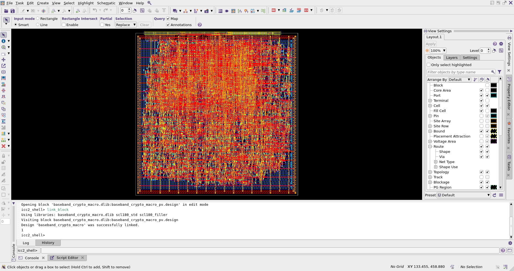

# RFID Group-2: Baseband and Cryptographic Subsystem (`baseband_crypto_macro`)

**Course:** RTL to GDSII  
**Under the Guidance of:** Prof. Mahima Arrawatia  

### 👥 Authors (Group 2)
* **Spandan Bharadwaj** (230102108)
* **Shreyas Sagar** (230102118)
* **Patel Dhruv Utkarsh** (230102112)

---

<p align="center">
  
</p>

## 📌 Project 4 Overview: Baseband and Cryptographic Subsystem

### 1. Responsibilities
* **Front-End (FE):** Design the Digital Baseband (DBB) featuring an asynchronous oversampling shift-register and a Manchester decoder Finite State Machine (FSM). Implement the **PRESENT-80** lightweight block cipher, fundamentally modifying the reference FSM to adhere to the **APB Streaming-Only Buffer Constraint**. Implement the AMBA APB slave interface and internal loopback multiplexers for isolated unit testing.
* **Back-End (BE):** Execute the complete RTL-to-GDSII physical design of the subsystem as an independent hard macro (`baseband_crypto_macro`) in the **SCL 180nm (4M1L) PDK**. Because the logic consists entirely of standard cells (`tsl18fs120`) with low combinational depth, this block serves as a low-friction introduction to the Place and Route (P&R) flow. Responsibilities include macro floorplanning, power grid generation, placement, clock tree synthesis (CTS), routing, antenna fixing, metal fill, STA signoff, and Calibre DRC/LVS physical verification.

### 2. Subblocks to Implement
1. **APB Wrapper & Loopback Multiplexer**
2. **DBB Oversampler & Majority Voter**
3. **DBB Manchester Decoder FSM & Byte Framer**
4. **PRESENT-80 Cipher Datapath (S-Boxes & Permutation)**
5. **PRESENT-80 Key Schedule & Shift Registers**

### 3. Top-Level Interface
```verilog
module crypto_rfid_top (
    input wire        clk,
    input wire        rst_n,
 
    // APB Slave Interface
    input wire        psel,
    input wire        penable,
    input wire        pwrite,
    input wire [31:0] paddr,
    input wire [31:0] pwdata,
    output wire [31:0] prdata,
    output wire        pready,
 
    // External RF Interface
    input wire        rfid_rx_bit,
    output wire        rfid_tx_bit
);
```

### 4. Operational Modes (Multiplexing & Testing Strategy)
An internal loopback multiplexer, controlled via the `CTRL_REG`, facilitates isolated unit testing:
* **Mode 0 (Live):** `rfid_rx_bit` $\rightarrow$ DBB $\rightarrow$ PRESENT Cipher $\rightarrow$ APB Read.
* **Mode 1 (DBB Loopback):** APB Write (Raw Oversampled Bits) $\rightarrow$ DBB $\rightarrow$ APB Read.
* **Mode 2 (Crypto Loopback):** APB Write (Plaintext) $\rightarrow$ PRESENT Cipher $\rightarrow$ APB Read.

### 5. Deliverables & Testing / Signoff Requirements
* **Deliverables:**
  * Functionally validated RTL for the DBB and PRESENT-80 cipher.
  * Verilog testbenches featuring APB Bus Functional Models (BFMs).
  * The final DRC/LVS-clean physical macro (`.lef`, `.lib`, `.gds`, `.def`, `.spef`, `.sdf`, `.sdc`, `_pnr_pg.v`, `_pnr_sim.v`).
* **Testing & Signoff Requirements:**
  * **Timing:** Macro-level STA signoff. Timing closure is straightforward due to the shallow combinational depth of the PRESENT-80 physical wiring permutation and 4-bit S-Boxes.
  * **Physical Signoff:** Standalone macro-level DRC and LVS signoff prior to handing the assembled block over to the SoC integration team.
  * **RTL Functional Testing:**
    1. Validation of the DBB Clock Data Recovery (CDR) logic by injecting synthetic Manchester-encoded waveforms into the testbench.
    2. Validation of the streaming constraint via APB-compliant testbench stimulus, checking against standard golden vectors.
  * 📄 **RTL Implementation & Testbench Validation Report:** Refer to **[`RTL_freeze_report_.pdf`](./RTL_freeze_report_.pdf)** in the repository root for complete RTL implementation and testbench validation details.

---

## 📊 Presentations & Reports in Repository
* **Project Overview Presentation:** [`Project4_Baseband_Crypto_Subsystem_updated.pptx`](./Project4_Baseband_Crypto_Subsystem_updated.pptx)
* **Group-2 Final Review Presentation:** [`G2_ppt.pptx`](./G2_ppt.pptx)
* **RTL Freeze & Validation Report:** [`RTL_freeze_report_.pdf`](./RTL_freeze_report_.pdf)
* **RTL Simulation Command Plan:** [`test_plan_v2.txt`](./test_plan_v2.txt)

---

## 🗂️ Repository Layout

Every directory and file in this repository is self-explanatory:

```text
RFID_Crypto/
├── FINAL_CALIBRE_signoff/                  # Final Calibre DRC, Dummy-Fill, Antenna & LVS signoff reports and logs
├── Final_GLS_post_pnr/                     # Post-PnR Gate-Level Simulation (SDF back-annotated) scripts and logs
├── Formality(LEC)/                         # Synopsys Formality Logical Equivalence Checking (LEC) scripts and reports
├── GLS_Pre_CTS__functional_verification/   # Pre-PnR (Post-Synthesis) Gate-Level Simulation scripts and reports
├── PNR/                                    # Synopsys ICC2 Place & Route TCL scripts, reports, and outputs
├── RTL/                                    # Synthesizable Verilog RTL source files (DBB, PRESENT-80, APB Wrapper)
├── sdc_final/                              # Synopsys Design Compiler synthesis TCL scripts, SDCs, netlists & reports
├── STA_primetime_signoff/                  # Synopsys PrimeTime Signoff STA TCL scripts, SDFs & timing reports
├── TB/                                     # RTL functional verification testbenches (APB, CDR, loopback modes)
├── TB_GLS/                                 # Gate-Level Simulation testbenches
├── Top_Level_Submissions/                  # Final macro deliverables for Top-Level SoC integration (.lef, .gds, .v, .sdc, .spef, .sdf)
├── G2_ppt.pptx                             # Group-2 Final Review Presentation PPT
├── Project4_Baseband_Crypto_Subsystem_updated.pptx  # Project Overview & Specification Presentation PPT
├── RTL_freeze_report_.pdf                  # Detailed RTL Implementation & Testbench Validation Report
├── project.zip                             # Physical Verification (Calibre DRC/LVS) workspace archive
└── test_plan_v2.txt                        # Exact command sequence to run RTL functional simulations
```

---

## ⚠️ COMPULSORY WORKSPACE SETUP IN MOBAXTERM

1. **Download `RFID_v2.zip` from the Releases link:**  
   👉 **[http://172.16.117.242:8080/Group2/RFID_Crypto/releases/download/RFID_v2/RFID_v2.zip](http://172.16.117.242:8080/Group2/RFID_Crypto/releases/download/RFID_v2/RFID_v2.zip)**
2. **Download `project.zip` from the root of this repository:**  
   👉 **[Download `project.zip`](./project.zip)**
3. **Download the compulsory root TCL scripts:**
   * All synthesis TCL scripts from **`sdc_final`** (`synth_final.tcl`, `synth_ff.tcl`)
   * The Pre-PnR GLS TCL script from **`GLS_Pre_CTS__functional_verification`** (`run_pure_gls.tcl`)
   * The Formality LEC TCL script from **`Formality(LEC)`** (`run_formality_final.tcl`)

> **🚨 NOTE (COMPULSORY): Extract `RFID_v2.zip` (`RFID_v2/`) and `project.zip` (`project/`) in MobaXterm and keep BOTH folders in the exact same parent directory, along with the `sdc_final` TCL scripts (`synth_final.tcl`, `synth_ff.tcl`), the Pre-PnR GLS script (`run_pure_gls.tcl`), and the Formality script (`run_formality_final.tcl`). These are COMPULSORY—the folders and scripts MUST be kept in this exact fashion in the same directory or the scripts will NOT run!**

```text
<Parent_Working_Directory>/
├── RFID_v2/
├── project/
├── synth_final.tcl
├── synth_ff.tcl
├── run_formality_final.tcl
└── run_pure_gls.tcl
```

---

## 🚀 Step-by-Step Execution Commands

### 1. RTL Functional Simulation (TB RTL)
Open [`test_plan_v2.txt`](./test_plan_v2.txt) in the repository and run the exact commands inside `csh`:

```csh
csh
source cad_cshrc
# Run the exact simulation commands given inside test_plan_v2.txt
```
* **Check Results:** Look at the command line output to verify that all test cases have **PASSED**.

---

### 2. Logic Synthesis (Design Compiler)
```csh
csh
source synopsys_cshrc
dc_shell -f synth_final.tcl
dc_shell -f synth_ff.tcl
```
* **Outputs:** Check `RFID_v2/sdc_final/output/` for the synthesized netlist (`.v`) and constraints (`.sdc`).
* **Reports:** Check `RFID_v2/sdc_final/reports/` for setup, hold, area, power, and QoR reports.

---

### 3. Logical Equivalence Checking - LEC (Formality)
```csh
csh
source synopsys_cshrc
fm_shell -f run_formality_final.tcl
```
* **Check Results:** Check the command line output for **`Verification SUCCEEDED`**.

---

### 4. Pre-PnR Gate-Level Simulation (Pre-PnR GLS)
```csh
csh
source cad_cshrc
chmod +x run_pure_gls.tcl
./run_pure_gls.tcl
```
* **Check Results:** Go to `RFID_v2/TB_GLS_v2_reports/`, open the simulation log files, and check the end of each log for the pass results.

---

### 5. Place and Route - PnR (Synopsys ICC2)
First, build the NDM reference libraries (`lm_shell`), then launch the ICC2 GUI (`icc2_shell -gui`):

```csh
csh
source synopsys_cshrc
lm_shell -f RFID_v2/pnr_icc2/TCL_pnr/build_ndm_std.tcl
exit
lm_shell -f RFID_v2/pnr_icc2/TCL_pnr/build_ndm_filler.tcl
exit
icc2_shell -gui
```
Inside the ICC2 GUI, execute the scripts from `RFID_v2/pnr_icc2/TCL_pnr/` in the following exact sequence:
1. `design_setup.tcl`
2. `floorplanning.tcl`
3. `powerplanning.tcl`
4. `placement.tcl`
5. `cts.tcl`
6. `route.tcl`
7. `fix_antenna.tcl`
8. `metal_fill.tcl`
9. `pv.tcl`

* **Outputs:** Go to `RFID_v2/pnr_icc2/outputs/` for `.gds`, `.lef`, `.def`, `.sdc`, `_pnr_pg.v`, `_pnr_sim.v` netlists, `.spef`, `.sdf`, and more.
* **Reports:** Go to `RFID_v2/pnr_icc2/reports/` for congestion, utilization, QoR, timing, `check_routes`, `check_legality`, `check_pg_connectivity`, `check_pg_drc`, `check_lvs`, and more.

---

### 6. Static Timing Analysis - STA (Synopsys PrimeTime)
```csh
csh
source synopsys_cshrc
pt_shell -f RFID_v2/pnr_icc2/STA_Primetime/TCL_primetime/sta_setup_ss.tcl
pt_shell -f RFID_v2/pnr_icc2/STA_Primetime/TCL_primetime/sta_hold_ff.tcl
```
* **Reports & Outputs:** Go to `RFID_v2/pnr_icc2/STA_Primetime/` to inspect the `reports_setup_ss/` and `reports_hold_ff/` directories for Setup and Hold timing reports, as well as `outputs/` for the signoff `.sdf` files.

---

### 7. Post-PnR Gate-Level Simulation (Post-Routing GLS)
```csh
csh
source cad_cshrc
chmod +x RFID_v2/GLS_post_routing/TCL_gls/run_all_gls.sh RFID_v2/GLS_post_routing/TCL_gls/run_gls.sh
./RFID_v2/GLS_post_routing/TCL_gls/run_all_gls.sh
```
* **Check Results:** Go to `RFID_v2/GLS_post_routing/` and check the `logs/` directory to verify both `ff` corner and `ss` corner simulation results.

---

### 8. Calibre DRC, Dummy Fill & Antenna Checks
```csh
csh
source mentor.cshrc
cd project/pv/drc/

calibre -drc -hier -turbo 4 drc_runset.svrf | tee drc_run.log
calibre -drc -hier -turbo 4 dummyfill_runset.svf | tee dummyfill_run.log
calibre -drc -hier -turbo 4 antenna_runset.svf | tee antenna_run.log
```
* **Check Results:** Look for **`TOTAL RESULTS GENERATED = 0 (0)`** after each command.

---

### 9. Calibre LVS Check
```csh
csh
source mentor.cshrc
cd project/pv/lvs/

v2lvs -v /storage/EE5239G2/RFID_v2/pnr_icc2/outputs/baseband_crypto_macro_pnr_pg.v -lsp /storage/PDK_iitg/SCLPDK_V3.0_KIT/scl180/stdcell/fs120/4M1IL/cdl/scl18fs120_supply_pins.cdl -lsp /storage/PDK_iitg/SCLPDK_V3.0_KIT/scl180/iopad/cio250/4M1L/cdl/tsl18cio250.cdl -s /storage/PDK_iitg/SCLPDK_V3.0_KIT/scl180/stdcell/fs120/4M1IL/cdl/scl18fs120_supply_pins.cdl -s /storage/PDK_iitg/SCLPDK_V3.0_KIT/scl180/iopad/cio250/4M1L/cdl/tsl18cio250.cdl -o baseband_crypto_macro.sp

calibre -lvs -hier -turbo 4 lvs_runset.svf | tee lvs_run.log
```
* **Check Results:** Look for the LVS result banner showing **`CORRECT`**.
